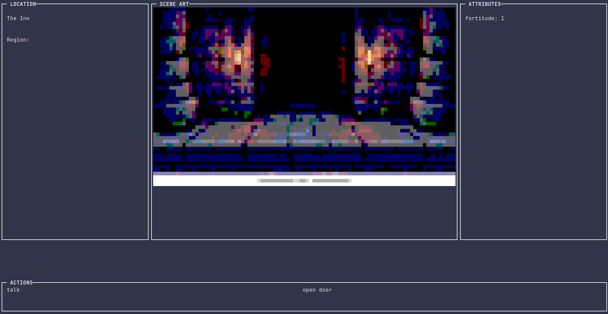

# Unmei
A ssh dungeon crawler game, with a dedicated mariadb backend hosted through an ec2 instance

## Features
- No download required
- Minimal to no overhead
- Full backend server handling saves and player account info
- Terminal interface + future plans for extra windows

## The game
Unmei stands for fate or destiny in japenese, i havent finished the games full storyboard, but the main idea is your a hero who encounters mystery after mystery which all will lead to the grand fate. This is week -1 of 12, each week i will expand the story and content.

## This version
This current version as stated is hosted on an ec2 instance to protect my computers, and its easiest for now. In addition i have set up the db that will hopefully carry me through to the end of this event, when a player ssh into the server it will either auto login for them or give them the option to login themselves, or create a new account (warning dont login if your ssh is already registered - havent tested this).

This allows auth to be a simple process for reccuring users. The current game loop isnt in place however the first page that opens is a relative style that the game will go for, read my docs for more info.

## How to play
1. Install an ssh client
    Linux and MacOs should already have this but just insure you do have a ssh client (Linux: openSSH)

2. register a public key
    Now you have to create a public key, this is used for authentication and security (this will be saved)
        - "ssh-keygen -t ed25519"

3. SSH into the server instance 
    From here you simply just have to connect using the public key generated:
        - "ssh -i {Path/To/Key} --tt unmei@18.189.8.182"

## Final notes
This is an experimental game, security is minimal for now on your end, ive locked the user to be force command, if you find any security concerns let me know, Otherwise enjoy the demo, next week i will have a decent amount of scenes.
